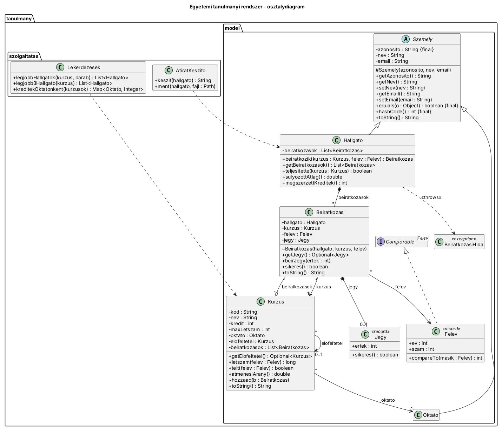

# Egyetemi tanulmányi rendszer – UML-ből Java

Egy régi tanulmányi rendszer UML-diagramjából felépített Java modell: hallgatók,
oktatók, kurzusok, beiratkozások és jegyek, az üzleti szabályokkal és JUnit
tesztekkel.

## Futtatás

Követelmény: JDK 21 és Maven (a NetBeans tartalmazza).

**NetBeansben:** File → Open Project → `Tanulmanyi`, majd **Run Project (F6)**.
A fő osztály: `tanulmany.Main`. A program kiírja a lekérdezések eredményét,
és elmenti Nagy Béla átiratát az `atirat_H1.txt` fájlba.

**Tesztek:** jobb klikk a projekten → **Test** (Alt+F6), vagy `mvn test`.
28 teszt fut, mind zöld.

## Szerkezet

```
src/main/java/tanulmany/
├── Main.java                  – demó adatok, lekérdezések, átirat mentése
├── model/
│   ├── Szemely.java           – absztrakt ős, equals/hashCode az azonosító alapján
│   ├── Hallgato.java          – beiratkozik(), súlyozott átlag, megszerzett kredit
│   ├── Oktato.java
│   ├── Kurzus.java            – kredit, max létszám, oktató, előfeltétel, átmenési arány
│   ├── Beiratkozas.java       – hallgató + kurzus + félév + Optional<Jegy>
│   ├── Jegy.java              – record, 1–10
│   ├── Felev.java             – record, Comparable
│   └── BeiratkozasiHiba.java  – üzleti szabály megsértése
└── szolgaltatas/
    ├── Lekerdezesek.java      – Stream API: top 3 hallgató, kreditek oktatónként
    └── AtiratKeszito.java     – átirat félévenként csoportosítva, fájlba mentve
src/test/java/tanulmany/       – 28 JUnit 5 teszt
docs/osztalydiagram.puml/.png  – UML osztálydiagram
```

## UML



| Kapcsolat | Számosság | Fajta | A kódban |
|---|---|---|---|
| Hallgato – Beiratkozas | 1 – * | kompozíció | a lista a `Hallgato`-ban van, a `Beiratkozas` konstruktora package-private |
| Beiratkozas – Kurzus | * – 1 | asszociáció | kötelező konstruktorparaméter |
| Kurzus – Beiratkozas | 1 – * | aggregáció | a kurzus csak hivatkozik a beiratkozásokra (létszám, átmenési arány) |
| Beiratkozas – Felev | * – 1 | asszociáció | kötelező konstruktorparaméter |
| Beiratkozas – Jegy | 1 – 0..1 | kompozíció | `Optional<Jegy> getJegy()` |
| Kurzus – Oktato | * – 1 | asszociáció | kötelező konstruktorparaméter, `null`-ra kivétel |
| Kurzus – Kurzus (előfeltétel) | * – 0..1 | asszociáció | `Optional<Kurzus> getElofeltetel()` |
| Szemely ← Hallgato, Oktato | | öröklés | absztrakt ős |

## Üzleti szabályok

- Telt kurzusra nem lehet beiratkozni (`BeiratkozasiHiba`).
- Ugyanarra a kurzusra egy félévben csak egyszer lehet beiratkozni.
- A jegy 1 és 10 közötti egész, ezt maga a `Jegy` record ellenőrzi.
- Előfeltételes kurzusra csak az előfeltétel teljesítése után lehet beiratkozni.

## Eltérések a szöveges leírástól, és miért

- **A félév `record Felev(int ev, int szam)`**, nem szöveg. Így validálható
  (a szám 1 vagy 2), és `Comparable`, ezért az átirat időrendben jelenik meg.
- **A `Beiratkozas` csak a `Hallgato.beiratkozik()` metódussal jöhet létre.**
  Ez a kompozíció kódbeli megfelelője, és így minden szabály egy helyen fut le,
  nem lehet megkerülni.
- **A `Kurzus` is ismeri a beiratkozásait** (kétirányú kapcsolat). A leírás
  ezt nem említi, de a létszámhoz, az átmenési arányhoz és a top 3-hoz kell.
  Kívülről csak módosíthatatlan listaként érhető el.
- **A maximális létszám félévenként értendő**, mert minden félévben új csoport
  indul.
- **Plusz szabály:** egy már teljesített (jegy ≥ 5) kurzusra nem lehet újra
  beiratkozni, így a kredit sem számolódik kétszer. Bukás után a következő
  félévben újra fel lehet venni.
- **Az `Oktato` nem tárolja a kurzusait.** A kapcsolat a kurzus felől
  navigálható, az oktatónkénti kreditösszeget a kurzusok listájából számoljuk.
- **Számítások jegy nélküli beiratkozásnál:** a súlyozott átlagba és az
  átmenési arányba csak a jeggyel lezárt beiratkozások számítanak. Ha nincs
  jegy, az eredmény 0.0.
- **Top 3 hallgató:** ha valaki többször vette fel a kurzust, a legjobb jegyével
  és csak egyszer szerepel (`distinct()`, ami a `Szemely.equals`-ra épül).
- **`equals`/`hashCode` csak a `Szemely`-ben**, `final`-ként, az azonosító
  alapján (`instanceof`), tehát ugyanaz az azonosító ugyanazt a személyt jelenti.
  A `Jegy` és a `Felev` recordként kapja meg ezeket automatikusan.

## Extrák

- `Felev` record `Comparable`-lel rendezve.
- Átirat szöveges fájlba, félévenként csoportosítva (`AtiratKeszito`).
- Előfeltétel-rendszer (`Kurzus.getElofeltetel()`).

## SOLID

- **S:** a modell az adatokat és a szabályokat tartja, a lekérdezések és az
  átirat külön osztályban vannak, és az átirat összeállítása (`keszit`) külön
  van a fájlba írástól (`ment`).
- **O:** új lekérdezés a modell módosítása nélkül hozzáadható.
- **L:** a `Hallgato` és az `Oktato` bárhol használható, ahol `Szemely` kell.
  Az `equals` `final`, így egy alosztály sem rontja el a szerződést.
- **I:** a szolgáltatások csak azt kérik, amire szükségük van (pl. `Collection<Kurzus>`).
- **D:** a lekérdezések `Collection`/`List` interfészeket használnak, nem konkrét
  implementációt.
